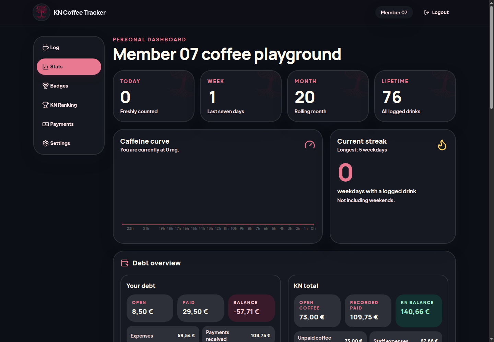
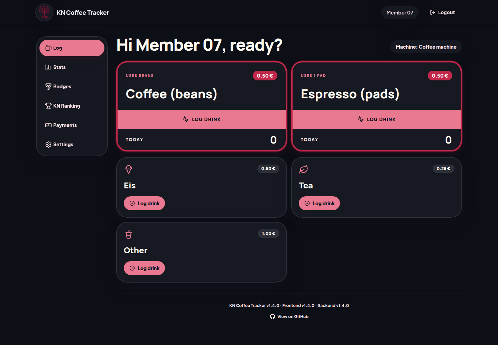
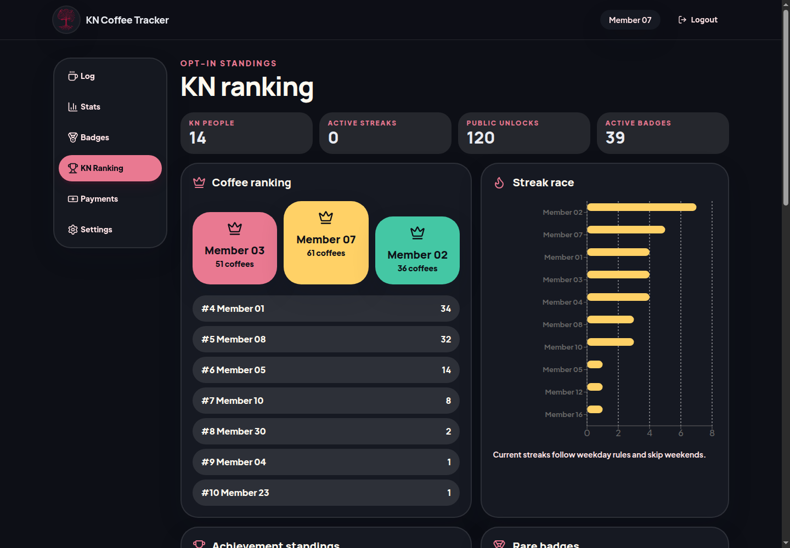
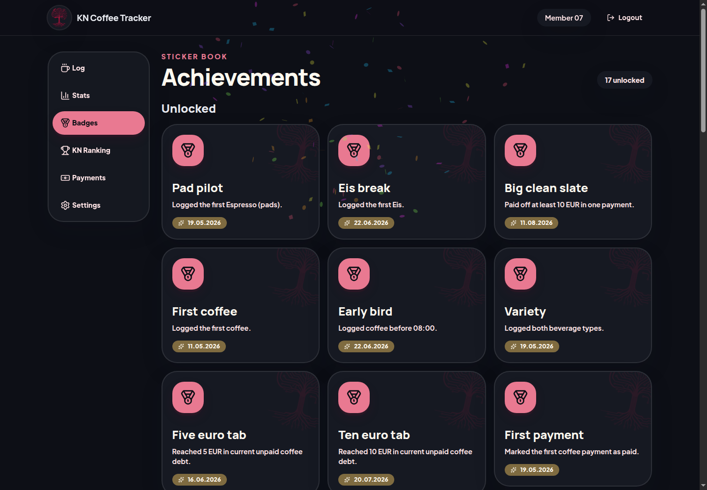
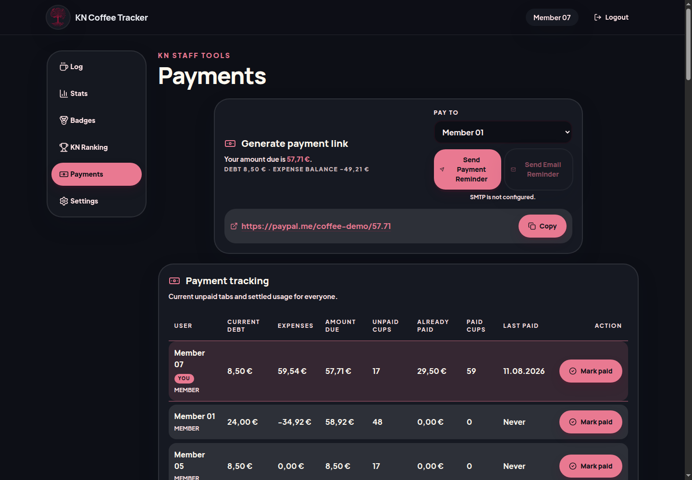
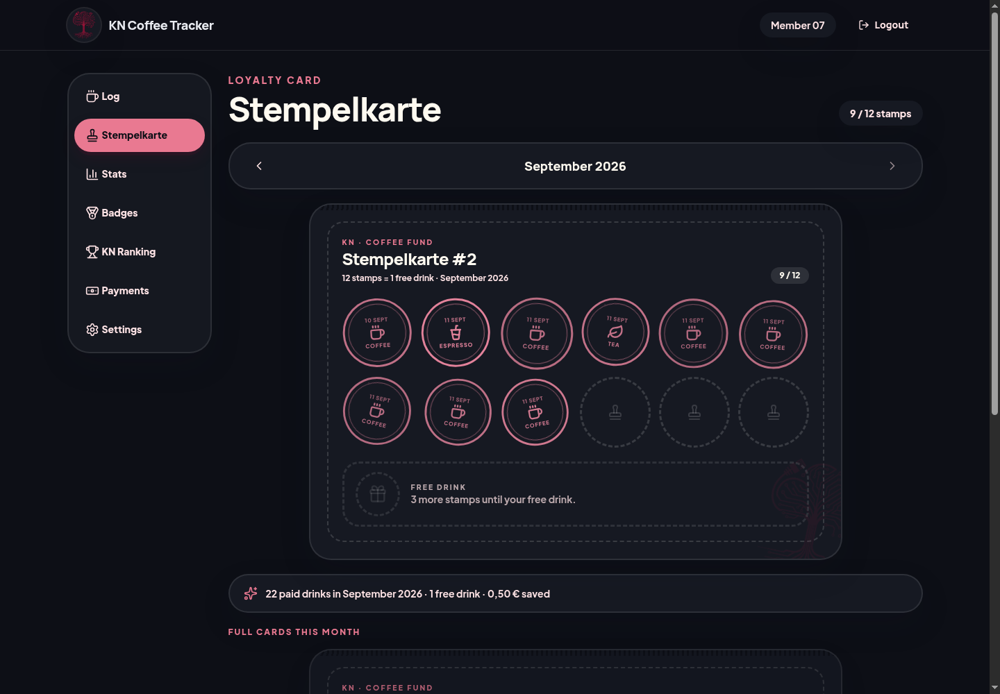
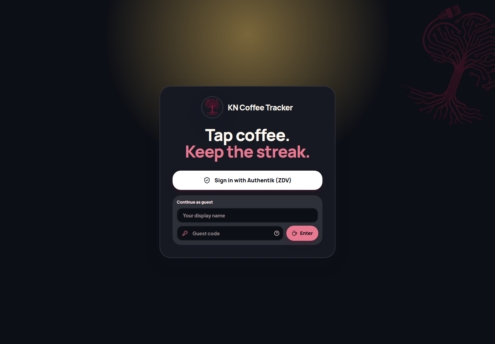
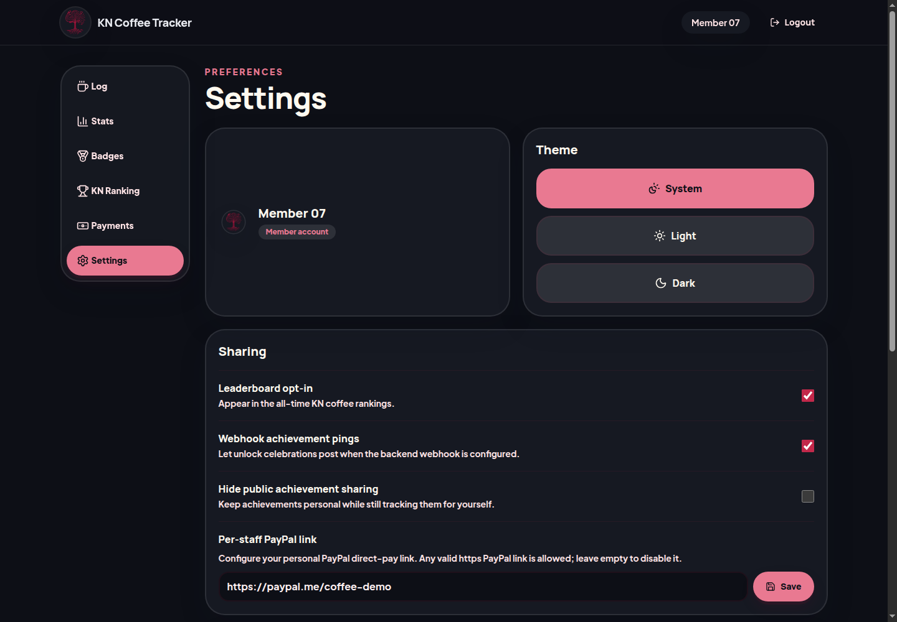

<p align="center">
  
</p>

<h1 align="center">Coffee Tracker</h1>

<p align="center">
  A cheerful, self-hosted coffee tally for teams—one tap from cup to statistics.
</p>

<p align="center">
  <a href="https://github.com/n1tr0-5urf3r/coffee-tracker/actions/workflows/ci.yml"></a>
  
  
  
  <a href="LICENSE"></a>
</p>

<p align="center">
  
</p>

## Everything around the coffee machine

- **Tap-to-log drinks** with optimistic feedback, a short undo window, QR-ready machine links, and an IndexedDB offline queue.
- **Personal analytics** for totals, caffeine decay, weekday streaks, hourly rhythm, beverage mix, and a calendar heatmap.
- **Social stats** with an opt-in leaderboard, achievement standings, rare badges, streak races, and coffee-twin matching.
- **Stempelkarte loyalty card** where every paid drink earns a stamp, the 13th drink of the month is free, and the discount lands straight on the open tab.
- **Shared payments** covering open tabs, payment links, settlement history, expenses, and optional email or webhook reminders.
- **Stock tracking** that decrements ingredients per drink and sends low-stock alerts when configured thresholds are crossed.
- **Flexible identity** through GitLab OAuth, Authentik/OpenID Connect, or recoverable guest sessions, with configurable access and staff groups.
- **Installable and self-hosted** as a responsive light/dark PWA backed by a single SQLite database.

<table>
  <tr>
    <td></td>
    <td></td>
  </tr>
  <tr>
    <td align="center"><strong>Fast logging</strong></td>
    <td align="center"><strong>Friendly competition</strong></td>
  </tr>
  <tr>
    <td></td>
    <td></td>
  </tr>
  <tr>
    <td align="center"><strong>Unlockable achievements</strong></td>
    <td align="center"><strong>Shared tabs and expenses</strong></td>
  </tr>
  <tr>
    <td colspan="2"></td>
  </tr>
  <tr>
    <td colspan="2" align="center"><strong>Stamp cards and free drinks</strong></td>
  </tr>
</table>

<details>
  <summary><strong>More screenshots</strong></summary>
  <br>
  
  
</details>

_Screenshots use an anonymized copy of the database._

## Quick start

You need Docker with Compose v2.

```sh
git clone https://github.com/n1tr0-5urf3r/coffee-tracker.git
cd coffee-tracker
cp .env.example .env
docker compose up --build -d
```

Open `http://localhost:3123`. The API and Swagger UI are available on port `3124` at `/api/v1` and `/swagger-ui`.

For a deployment using the published images, run:

```sh
docker compose -f docker-compose.yml up -d
```

The frontend image is configured **at container startup**, not build time. The same image can be branded for another team by changing `.env` and restarting the container.

## Configuration

All deployment-specific values live in `.env`; see [`.env.example`](.env.example) for the complete list.

| Area           | Variables                                                                                     |
| -------------- | --------------------------------------------------------------------------------------------- |
| Branding       | `APP_NAME`, `ORGANIZATION_NAME`, `ORGANIZATION_SHORT_NAME`, `STAFF_LABEL`, `OIDC_LOGIN_LABEL` |
| Logo           | Set `LOGO_URL=/branding/logo.png`, place the file in `BRANDING_DIR`, and restart the frontend |
| URLs           | `PUBLIC_BASE_URL`, `FRONTEND_BASE_URL`, `API_BASE_URL`, `ALLOWED_HOSTS`                       |
| Authentication | `GITLAB_*`, `AUTHENTIK_*`, `AUTH_ALLOWED_GROUPS`, `AUTH_STAFF_GROUPS`                         |
| Integrations   | `MATTERMOST_WEBHOOK_URL`, `MATRIX_WEBHOOK_URL`, `PAYPAL_LINK`, `SMTP_*`                       |
| Runtime        | `SESSION_SECRET`, `TIMEZONE`                                                                  |

OAuth callback URLs are:

```text
https://your-coffee-host.example/api/v1/auth/gitlab/callback
https://your-coffee-host.example/api/v1/auth/authentik/callback
```

## Support the project

If Coffee Tracker makes your coffee corner a little more fun, consider fueling the next round of improvements.

<p align="center">
  <a href="https://www.paypal.com/donate/?hosted_button_id=KXMYX49C6MLLN">
    
  </a>
</p>
